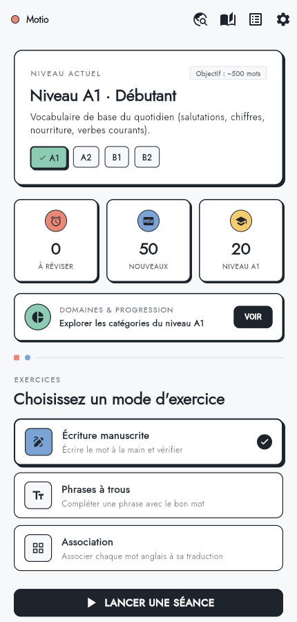
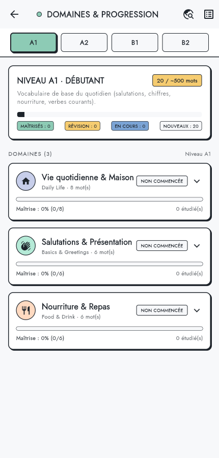
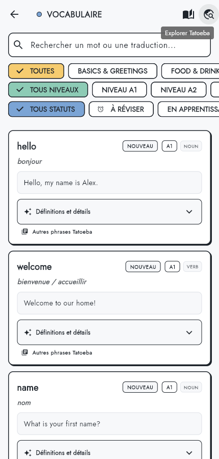
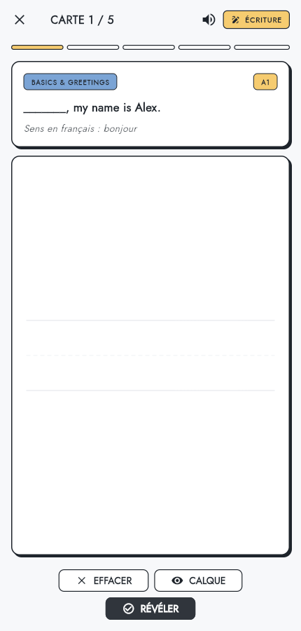

# Motio

[](https://github.com/Croquette1995/Motio/actions/workflows/build-android.yml)


> **FR** — **Motio** est une application d'apprentissage du vocabulaire anglais (niveaux CECRL A1 à B2). Elle associe répétition espacée, exercices d'écriture manuscrite, phrases à trous, association de paires, consultation de définitions et exploration de phrases bilingues.
>
> **EN** — **Motio** is an English vocabulary learning application (CEFR levels A1 to B2). It combines spaced repetition, handwriting practice, fill-in-the-blank exercises, pair matching, dictionary definitions, and bilingual sentence exploration.

---

## Fonctionnalités / Features

| Fonctionnalité / Feature | Description (FR) | Description (EN) |
| :--- | :--- | :--- |
| **Répétition espacée (SRS)** | Planification des révisions selon les réussites et échecs (`Nouveau`, `En apprentissage`, `En révision`, `Maîtrisé`). | Review scheduling based on recall success and failure (`New`, `Learning`, `Review`, `Mastered`). |
| **Trois modes d'exercice** | Écriture manuscrite sur zone de dessin (avec reconnaissance embarquée sur mobile), phrases à trous en contexte et association anglais/français. | Handwriting canvas (with on-device mobile recognition), fill-in-the-blank sentences, and English/French pair matching. |
| **Niveaux CECRL & Domaines** | Sélection du niveau actif (A1 à B2) et suivi de la progression par domaine thématique (9 catégories). | Active level selection (A1 to B2) and progress tracking across 9 thematic domains. |
| **Vocabulaire & Définitions** | Catalogue filtrable (catégorie, niveau, statut, recherche) avec définitions, synonymes et étymologie via Wiktionnaire. | Filterable word catalogue (category, level, status, search) with Wiktionary definitions, synonyms, and etymology. |
| **Explorateur Tatoeba** | Recherche de phrases bilingues anglais/français et ajout de mots extraits à la base locale sans doublon. | Bilingual English/French sentence search with duplicate-free addition of extracted words to the local database. |
| **Synthèse vocale (TTS)** | Prononciation des mots et phrases d'exemple avec choix de voix, vitesse, tonalité et volume. | Text-to-speech playback for words and example sentences with configurable voice, rate, pitch, and volume. |

---

## Captures d'écran / Screenshots

| Accueil / Dashboard | Domaines / Domains | Vocabulaire / Vocabulary | Exercice / Practice |
| :---: | :---: | :---: | :---: |
|  |  |  |  |

---

## Technologies

- **Flutter & Dart** : base de code unique pour Android, iOS, Linux et Web.
- **Riverpod & GoRouter** : gestion d'état réactive et navigation déclarative.
- **Drift (SQLite)** : stockage local hors-ligne typé sur mobile et Web (WASM).
- **Google ML Kit (Digital Ink)** : reconnaissance d'écriture manuscrite embarquée sur mobile.
- **Dio** : requêtes HTTP vers les API publiques Wiktionnaire et Tatoeba (sans clé API).
- **Flutter TTS** : lecture vocale des mots et phrases d'exemple.

---

## Installation & Commandes / Setup & Commands

### Prérequis / Prerequisites

- **Flutter SDK** (stable) et **Dart SDK** (`>= 3.11.0 < 4.0.0`)

### Lancer en local / Run Locally

```bash
git clone https://github.com/Croquette1995/Motio.git
cd Motio
flutter pub get

# Mobile / Desktop
flutter run

# Web
flutter run -d chrome
```

### Tests, Analyse & Build / Tests, Analysis & Build

```bash
# Analyse statique
flutter analyze

# Tests unitaires et widgets
flutter test

# Build APK Android
flutter build apk --split-per-abi
```
